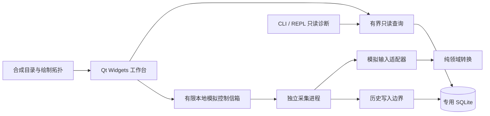

# C++ 模拟首版：架构与后续 Agent 交接

本文件是公开仓库中 C++ 实验首版的单一架构交接入口。只描述通用软件边界和匿名模拟，不包含现场流程、设备配置、端点、点表、协议握手或外部材料。模拟不是正式实现。运行命令见 [cpp-runtime/README.md](cpp-runtime/README.md)，实际验证见 [cpp-runtime/VALIDATION.md](cpp-runtime/VALIDATION.md)。

## 决策与目录

使用 C++17 / CMake。领域层只依赖标准库，不依赖 Qt、SQLite、网络或设备 SDK。旧 Node、Pi、契约文件独立保留；新程序不声称兼容旧工具或替代旧实现。

| 目录/模块 | 职责与允许依赖 |
|---|---|
| `cpp-runtime/src/domain.hpp/.cpp` | 纯合成状态转换；仅标准库 |
| `cpp-runtime/src/adapters.hpp/.cpp` | `SampleSource`、`HistorySink` 边界，唯一已实现输入是 `SimulationAdapter`；可依赖领域层 |
| `cpp-runtime/src/core.hpp/.cpp` | SQLite 写入适配器 `Writer`、只读查询 `read`、有界结果 `View`；不依赖 Qt |
| `cpp-runtime/src/control.hpp/.cpp` | 同用户本地文件锁信箱，仅四个模拟命令；无网络端口 |
| `cpp-runtime/src/catalog.hpp/.cpp` | 合成目录：工厂、业务模式、线体、工位、控制器与库区；只用稳定 ID 和关系表；仅标准库 |
| `cpp-runtime/src/schematic.hpp/.cpp` | Qt QPainter 绘制通用合成拓扑；工位绘制与点选共用矩形 |
| `cpp-runtime/src/workbench.hpp/.cpp` | Qt 工具栏、可调分栏、详情表、历史表、状态栏；目录浏览不写库 |
| `cpp-runtime/src/collector.cpp` | 组合模拟输入和存储适配器；独立采集进程 |
| `cpp-runtime/src/diagnose.cpp` | 有界只读 CLI/REPL；只调用查询边界 |
| `cpp-runtime/src/hmi.cpp` | Qt Widgets 中文工作台；只读查询 + 独立有限模拟控制请求，不写库 |
| `cpp-runtime/tests` | 纯领域、目录约束、独立进程黑盒验收、真实 Qt 事件循环与联动测试；全部合成数据 |

依赖方向是入口/界面 → 边界模块 → 领域；基础设施不得反向进入领域。当前小型 `runtime_core` 库同时承载读写基础设施实现，读端 API 与写端类分离，运行时只读由 SQLite open flags 和 query_only 执行。未来可按编译目标拆分库，但不得为了拆分改变已有观测语义。



## 进程与故障边界

采集由用户单独启动，不由 HMI/CLI 充当唯一父进程或服务监督者。界面退出、诊断退出不停止采集。Qt 定时器只检查异步查询是否完成，不在界面线程等待 SQLite；最多一个在途查询。查询失败或证据过期必须可见，不能继续将历史值显示为当前可信状态。

数据放专用本地目录，与源码、构建和旧数据库分离。SQLite 单写者，由独立租约排他事务约束；多写者启动失败。每帧事务提交、WAL/FULL；进程重启保留已提交历史并更换启动标识。v1→v2 只增加运行模式/心跳表，原始历史保留。采集器重启恢复已提交模式与合成阶段，不把此模拟恢复称作真实业务恢复。数据目录/schema 不匹配拒绝运行，禁止自动覆盖。暂不支持共享盘、生产服务安装、历史容量管理、物理掉电保证或生产高可用。

质量与数值分开。不可用观测存空值，不能用零冒充成功采样。顺序由持久序号表达，墙钟只提供时间证据；启动内单调时间不能跨启动比较。对覆盖不足只报告 unknown，不把没有匹配记录推断成没有异常，也不自动推断根因。

## 模拟模式与本地控制边界

采集器独占自动/手动模式、场景推进和 SQLite 写入。新目录默认自动；切换手动后停止定时推进，只有明确的单步请求生成下一帧。手动待步仍每 200ms 持久发布进程心跳；任务事件时间与进程存活证据独立。界面不能因为事件未更新就把手动等待标成断链。心跳超过 1500ms 或墙钟不确定时禁用控制并显示未知。

自动恢复必须经过界面确认对话框，默认选择继续手动。命令在采集端校验和提交后界面才显示新模式；等待期间禁用按钮。HMI 退出/重开不发任何模式或推进命令。已确认模式与合成阶段跨采集器重启保留，启动身份更新以拒绝旧请求。

`control.mailbox` 是专用本地目录内的单槽文件信箱；通过 POSIX flock / Windows LockFileEx 互斥读写，不使用套接字、共享 SQLite 写权限或通用 RPC。仅允许 `manual`、`automatic_confirmed`、`step`、`disconnect` 四种固定枚举。step/disconnect 仅手动可用；模拟断链生成坏质量空值帧，不连接或写入设备。请求最多 512 字节，绑定启动身份、已确认操作修订号和 1500ms 截止时间；重复/过期/旧会话请求拒绝。成功操作与操作修订号同一 SQLite 事务提交，随后回执。客户端超时不自动重试，明确提示结果可能未知，要求核对状态。并发请求忙时失败，不排入无界队列。

文件信箱是同一受信任操作系统账户的本地模拟工具，不是对抗恶意同用户进程的授权系统。Linux 新建信箱权限 0600；Windows 继承用户私有目录 ACL，仍需目标机验证。禁止共享盘、多用户共享可写目录和复制此通道作为现场控制面。信箱损坏输入有界拒绝；存储失败仍显式终止采集，不伪报成功。

CLI/Pi 继续只读；`control_test_client` 仅在 BUILD_TESTING 构建的测试夹具中存在，不作为产品诊断命令或 Pi 工具。本机模拟手自动模式不得直接复用到现场：真实控制权、联锁、权限和专门验收都需要另外确认。

## Qt 工作台设计

保留原生 Qt Widgets / C++17，不使用 WebView 或 Qt Charts。工作台默认单屏。顶栏诊断菜单打开独立窗口，可查看工位、采集、接口、事件、日志和点表。关闭窗口保留主屏工位和步骤。顶部依次选择工厂、业务模式、线体和工位。关联 PLC 提供辅助入口。采集心跳与手自动独立显示。主内容顶对齐。页签栏不显示。蓝色只标当前模块、当前工位和主操作。质量正常用浅绿，未知和未连接用灰，模拟质量不可用或模拟链路断开用琥珀，并写明这不是现场设备离线。

只有目录里绑定 `sim.three-cart.v1` 的工位 140 显示实时帧、三车阶段、事件历史、模拟日志和采集序号。聚焦 150、160 或其他 PLC 时，这些页面不列出 140 的帧或日志；顶栏心跳仍表示采集进程还在，并标明当前 PLC 未绑定该源。150 和 160 的示意图不画 140 的三车颜色。切页、筛选和搜索不写库，也不改变采集。

模拟日志在 schema v3 的 `sim_logs`。新库从 v1 建表再迁到 v2（`runtime_state`）和 v3。采集类日志只在链路或质量相对上一帧发生变化时写一条短句；相位 10 和 11 都是断开，只记一次。业务日志只在三车阶段变化时写。表保留最近 300 行。重启时从最后一帧恢复上次链路、质量和阶段，避免把相同状态再记一遍。对象列展示「外装 · 工位 140」，源码 `sim.three-cart.v1` 留在详情。长的「不是现场离线、没有 S7 重连」说明放在日志页一次，不放进每一行。不记录凭据、二维码或物料原文。读库失败走界面的不可用提示，不把失败显示成正常。

采集进程用 `writer.lease` 的独占事务保证同一目录只有一个写入者。界面只做只读快照和有限模拟命令。质量坏或链路断开时小车值保持未知，不补零。上位机手自动和 PLC 自动是两个字段，后者界面保持未读取。

视觉收尾参考了 Damir Sokolovsky 的 heydamir/unslop（CC BY 4.0）里可迁移的原则：安静的导航、间距节奏、状态色只表示真实含义、列表短句和详情分开。该技能没有装进本仓库，也没有执行它的安装、浏览器或生图脚本。中文字体是本机 Noto Sans CJK SC，时间列用 Noto Sans Mono CJK SC。Windows 字体、DPI 和文件锁没有测过。

目录层级是工厂 → 业务模式（SPS／排序区）→ 线体 → 工位。业务模式与采集端运行模式（手动／自动）是两个字段。关联使用稳定 ID：一个控制器可对应多个工位，库区另行关联工位，展示名可以重复，不能当键。切换父级时，子项 ID 仍属于新父级才保留，否则选中合法项；没有子项则显示未配置。

设备与通道由 Qt 本地绘制，画面标明“示意”。图中工位矩形与下拉双向同步。库存数量和设备连接保持未知／未探测，不造数。只有目录中明确标记为当前模拟流 `sim.three-cart.v1` 的工位显示实时帧、历史和原有手动／自动按钮。其他工位与排序区只显示静态示意，不复用该模拟流的阶段或历史。目录浏览不改变采集目标、不暂停自动推进、不切换手动／自动。

查询与控制各只有一个在途异步操作，界面线程不等 SQLite 或信箱。正常和手动两种界面以 1280×800 / 1100×650 渲染检查；中文字体优先 Noto Sans CJK SC，Windows 回退 Microsoft YaHei UI。Linux 图像不能替代 Windows 字体、DPI、文件锁或部署验收。

## Adapter 扩展纪律

`SampleSource::next()` 和 `HistorySink::append()` 是明确扩展入口，当前承载合成观察。未来真实输入的时间戳、标识、错误及类型契约须在另一次评审中补齐，不能把模拟格式当正式外部协议。当前没有正式外部适配器，没有外部网络调用，也没有通用写设备方法。

新的外部实现必须独立模块、独立配置和单独验收；依赖版本与安全构建选项须锁定。未确认接口不得编造；只有测试替身时必须标注模拟。私有配置、凭据、证书、真实样本、其他项目代码或发行二进制不得进入公开仓库。

本版无诊断网络服务。若后续增加服务，需另行设计 loopback 绑定、token 验证、参数与资源预算；不能把“本机”当作免鉴权依据。旧只读契约保持不变；任何兼容声明必须列出具体已验收路由及未支持项。

## 故障验收与构建

空构建目录验证核心和 Qt 两种构建；核心可 `-DBUILD_HMI=OFF`。测试至少覆盖正常状态、异常、坏质量空值、模拟断链恢复、重启/进程崩溃后的已提交历史、第二写者拒绝、诊断/HMI 生命周期独立，以及只读输入限额。Qt offscreen 测试验证真实 Widgets 数据刷新，不等于目标桌面验收。

Windows 使用用户可写 D: 目录、MSYS2 MINGW64、C++17、CMake `MinGW Makefiles` 和 `mingw32-make`；非 UCRT64，不要求 Ninja。Qt 与编译器必须匹配，不混用其他项目运行库，不依赖 Qt Charts。完整下载、构建、运行命令在运行 README 维护，避免两处漂移。Linux 测试不能替代 Windows 或现场验收。

## 给后续 Agent 的改动范围

1. 先读本文件、运行 README、验证记录及相关测试，核验工作分支和未提交更改。
2. 领域任务只改纯状态转换和对应测试；不要把数据库、界面或 SDK 引入领域。
3. 存储任务只改存储/查询边界及持久化测试；保持单写者、空值质量和旧数据拒绝覆盖。
4. 界面任务只改 Qt 展示、只读刷新及明确授权的模拟控制请求；不得管理采集进程、直接写库或新增设备写操作。
5. 诊断任务只改有界命令和证据展示；不得提供任意 SQL、shell、写点或虚构根因。
6. 外部适配任务先列出缺失契约与可复现本地验收，再独立实现；生产连接和部署不在本分支授权范围内。
7. 更新对应验证记录和本文件中的真实边界，只提交源码、测试与公开文档。不得修改 main、合并或发布；需要进一步授权的行为另行提出。

未实现事项必须保留为未实现，不通过命名、界面标签或文档将 mock 升格为正式功能。

## 钱塘二厂范围纠正

下面这一节是当前实验分支的界面范围，取代上一节里的虚构北岸／南湾目录。虚构目录属于已在 `experiment/cpp-runtime` 上的 `518cf6bd690d2a2779ffb8856e602dd3b6ec5dfb`。本交付在其后追加提交，并推回 `experiment/cpp-runtime`。`main` 保持 `82a8232202f39bd423d43c69cd19f7061cbc2336`，本轮不检出、不提交、不推送 `main`。

这是模拟示意版，不是现场布局验收，也不是生产上线。没有实测平面、层数、动线或信号状态。图题写明「通用示意，不是实测布局 · 层数与动线未提供」。Windows、DPI 和真实协议没有在本环境验证。

导航只有工厂「钱塘二厂」，区域只有「分拣区」「排序区」，然后是 PLC 配置和已给定工位。PLC 标识是本软件配置 ID（`plc.cfg.*`），没有型号或 IP。外装 140/150/160，仪表一 20/30/90，仪表二 40/10/70/80，排序一 210/220。排序二、三、四没有工位，保持未配置，不补造。线体没有记录，界面写明不按同 PLC 推断。

一台上位机看一个 PLC。导航停在 PLC，没有工位下拉。画面只画当前 PLC 的已知工位：带轮料车、机器人底座/立柱/关节/夹具、四柱料架和箱位，轻等距矢量，不是每工位一个大边框。聚焦靠点图或点编号。其他 PLC 的工位不进入这张图。

采集归属在 PLC，不给每个工位各开一份采集。现有三车模拟流只挂工位 140。图上三辆料车的阶段色与下方状态卡使用同一映射：等待为灰，扫码/分拣为蓝，完成为深色，阻塞或未知为琥珀。150、160、仪表和排序工位不复制 140 的帧、历史或点表。SQLite 仍保存 UTC 接收毫秒；界面把同一毫秒显示为北京时间（Asia/Shanghai，UTC+8），不改变时间戳语义。

LWMS、华睿、库卡只写成未连接、未授权或协议未定。库卡通行不根据心跳或设备运行放行。PLC 补料请求不写成 LWMS 完成确认。库位、箱、料映射显示待补。140 点表在 `point_audit` 中按来源保留重复项、空白名、方向冲突和 DBX 上的 int/string；`executable_write` 全部为 false，不生成可写点。其他工位不套用这份点表。

上位机手动／自动仍是采集进程的原有信箱语义：手动待步、单步一次、断链后单步继续同一采集器、恢复自动必须确认。PLC「设备运行中」显示为未读取。切换 PLC 不改变模式、修订号或启动身份。

实际通过的测试、环境和截图见 `cpp-runtime/VALIDATION.md` 开头一节。剩余待确认：现场平面与工位差异、层数和动线、LWMS／华睿／库卡协议、140 点表疑点的真实地址、Windows 字体与 DPI、生产权限和联锁。

## 联动导航交接

默认目录保留原演示流程，并添加北岸、南湾两个虚构工厂。每个工厂提供 SPS（立库）和排序区。线体通过独立的工位关系表配置，PLC 通过自己的工位归属关系配置。同一 PLC 可关联不同线体上的工位。新增库区与仓库名均为示例配置，库存仍为未知。

运行页使用深青页眉、紧凑上下文和约 40:60 双栏。左侧的阶段列表联动步骤说明，设备拓扑可用于导航。右侧按行展示当前步骤、质量、链路证据及近期记录。底部操作带常驻。顶栏独立显示当前工位、自动／手动和采集心跳。诊断内容使用弹窗访问，主屏保持原位置。

头部四个下拉依次按工厂、业务模式、线体过滤。拓扑或关联 PLC 入口可跨线浏览，选中工位后重新计算对应四级路径。空业务模式、空线和无工位 PLC 都有明确空态。工位 ID 决定模拟数据、日志、点表和控制的展示资格。只有原模拟流工位可用，排序区和新增工厂只有配置和拓扑。切换导航不会更改采集目标、数据库、手自动或当前任务。

回归和截图说明见 [验证记录](cpp-runtime/VALIDATION.md)。

## 下一轮实施交接

当前交接以上一节「钱塘二厂范围纠正」为准。下面从「本轮已实现的语义」起是 `518cf6bd690d2a2779ffb8856e602dd3b6ec5dfb` 的历史记录，其中的北岸／南湾目录已经替换，不要恢复工位下拉或全厂 SVG 方框。

上一基线 [92966ea](https://github.com/Sentheecode/logistics_trans_pi/commit/92966ea4336cc91c222d178242a57cc40e393799) 已有独立模拟采集、SQLite 单写者、只读诊断、Qt 工作台、手动单步与自动恢复确认。该记录从 `ab0d660d5a2cdf6f270b2a795e597fda33f6b5a9` 继续，只改实验分支。`main` 与 `origin/main` 保持 `82a8232202f39bd423d43c69cd19f7061cbc2336`。

### 早期实现记录（历史）

目录、示意图和界面都在 Qt 进程内，不进入领域状态机，也不改 `control.mailbox` 的四种命令。采集器仍是唯一写库进程。

- 夹具有北岸合成厂、南湾合成厂和没有业务模式的空目录厂。业务模式只有 `sps` 与 `sort`，与手动／自动分开存放。北岸 SPS 下有一条没有工位的空线。
- `stn.north.sps.a1`、`a2`、`a3` 同属 `ctl.alpha`。`stn.south.sps.c1` 与 `stn.south.sort.d1` 同属 `ctl.gamma`，跨业务模式。`stn.north.sps.a1` 与 `stn.south.sps.c1` 展示名都是“示意工位甲”，关系只认 ID。
- 父级变化后，子级 ID 仍落在新父级内才保留，否则取该父级的第一个合法项；没有子项时下拉显示“未配置”。
- 唯一实时工位是 `stream == sim.three-cart.v1` 的 `stn.north.sps.a1`。只有它显示三车阶段、历史和原有控制按钮。排序区、其他工厂和其他工位显示“未接入”或“未配置”，历史表为空。
- 库存单元格固定为“未知”，设备连接固定为“未探测”。采集进程在线不会被写成设备在线。
- 手动模式下连续切换下拉不改变模式、修订号、序号和启动身份。自动模式下改到排序区后，序号仍增加，修订号和模式不变，界面仍不显示这些帧。
- SVG 点选调用与下拉同一条选择路径。橙色框是同一控制器的其他工位，蓝色框是当前项。设备图是独立 SVG，文字包含“示意”。
- 损坏的 SVG 矩形不会被当成可点击工位。信箱命令、坏质量空值和手动确认对话框保持原语义。

没有加入网络客户端、OPC UA、端点、IP、DB 地址或真实点表。目录不是现场配置，也不能从演示节拍推断生产时序。

### 验证命令与结果

环境：Linux，GCC 13.3.0，CMake 3.28.3，SQLite 3.45.1，Qt 6.4.2（Widgets 与 Svg），Python 3.12.3，Node 22.23.4，字体 Noto Sans CJK SC。系统包提供这些依赖。配置 Qt 时出现 `Could NOT find XKB`；随后 `QT_QPA_PLATFORM=xcb` 仍在 Xvfb 上完成窗口抓图，因此不把缺少 XKB 开发头文件当成界面失败，也不把它当成键盘布局验收。

空目录 Release（含 Qt）与关闭 HMI 的核心构建都从干净目录执行。最后一次结果：

```bash
cmake -S cpp-runtime -B /tmp/logistics-release -DCMAKE_BUILD_TYPE=Release -DCMAKE_CXX_COMPILER=g++
cmake --build /tmp/logistics-release -j4
ctest --test-dir /tmp/logistics-release --output-on-failure
```

6/6 通过：`domain`、`catalog`、`modes`、`acceptance`、`widgets_controls`、`hmi_refresh`。合计约 30.5 秒。

```bash
cmake -S cpp-runtime -B /tmp/logistics-core -DBUILD_HMI=OFF -DCMAKE_BUILD_TYPE=Release -DCMAKE_CXX_COMPILER=g++
cmake --build /tmp/logistics-core -j4
ctest --test-dir /tmp/logistics-core --output-on-failure
```

4/4 通过：`domain`、`catalog`、`modes`、`acceptance`。没有生成 HMI。合计约 13.4 秒。

```bash
npm test --prefix runtime
```

49/49 通过，0 失败、0 跳过。旧 OPC UA 驱动目录有独立测试，本轮没有重跑，也不把它算进这 49 项。

`widgets_controls` 覆盖原手动单步、连点只提交一次、恢复自动的取消与确认、离线禁用，以及目录约束在界面上的表现：SVG 点击与四个下拉同步、下拉改选后示意图颜色反向更新、控制器多工位、跨工厂同名工位不串数据、空线与空厂、非实时工位不能控制且历史为空、手动浏览不改采集、自动浏览不暂停采集、1100×650 与 1280×800 的可见短标签和中文字形。`catalog` 覆盖关系校验和非法目录：重复 ID、悬空引用、一工位两控制器、两个实时流、把端点字符串写入流字段、把 `manual` 当作业务模式、展示名撞上别人的 ID。

### 运行与截图

截图由实际 `hmi` 进程在 Xvfb（1440×900）上用 `QT_QPA_PLATFORM=xcb` 调用 `QWidget::grab()` 生成，另用 ImageMagick `import -window root` 截虚拟桌面。文件不进 Git。抓图前先独立启动 `collector`。`manual` 那张在采集端确认手动模式之后再打开界面。`hmi` 的第五个参数可以是 `normal`、`manual`、`alarm`、`unavailable`、`sort`、`peers`、`south`、`empty`、`dropdown`；第六个参数 `compact` 为 1100×650。`dropdown` 会同时写出 `*-popup.png`。

已查看的抓图包括：SPS 自动与手动、业务模式下拉弹出“SPS／排序区”、控制器甲的 A1/A2/A3 高亮、排序区 B1/B2、南湾工厂 C1 与跨模式关联的 D1、空线“未配置”、告警帧，以及 1100×650。非实时画面的历史表为空，运行模式文本仍显示采集进程自己的手动或自动。

### 剩余待办

- 未在 Windows 11、MSYS2 MINGW64、Qt 6.11.x、MinGW GCC 16.2 或 CMake 4.4.4 上构建或运行。
- 未验收真实桌面 DPI、多显示器、窗口管理器主题和 Windows 文件锁。
- 未连接、未探测、未写入任何 PLC、OPC UA 服务器、AGV 或 LWMS。目录不能升格成现场配置。
- 未重跑 `runtime/drivers/opcua` 的独立测试，没有新增 open62541。
- 历史容量、物理掉电、生产权限和联锁仍未实现。信箱仍只是同一用户的本地模拟通道。
- SVG 命中只支持未使用 `transform` 的 `rect`。空目录厂有界面测试，但没有单独的空厂截图；空线截图已覆盖“未配置”。
- XKB 开发库缺失只记录为配置警告。

### Codex 复查入口

继续使用 https://github.com/Sentheecode/logistics_trans_pi/tree/experiment/cpp-runtime 。先读本段、[构建与启动](cpp-runtime/README.md) 和 [验证记录](cpp-runtime/VALIDATION.md)，再看 `cpp-runtime/src/catalog.*`、`schematic.*`、`workbench.*`、`tests/catalog.cpp` 与 `tests/widgets.cpp`。不要改 `main`，不要 force-push，不要为界面改领域、旧 Node/Pi 或信箱协议，不要添加设备地址或网络写入。复查时重跑上面三条命令；截图用 `hmi` 的捕获参数重新生成，不要把 PNG 提交进仓库。

### 模拟分拣单与共用通道

单屏用一个固定的合成示例单和物料展示链路。当前目标从同一可信模拟帧中处于扫码、分拣或阻塞的料车取出。工位完成进度只计该帧中明确完成的料车。等待间隔可以没有活动目标，坏质量和自动运行中过期帧显示目标及进度未知。该视图不建立额外的订单状态机或回执。

拓扑分别绘制固定工位的货架与机械臂，以及共用通道的三台料车。料车高亮与单据目标来自相同的帧投影，图中位置仅为示意，不对应工位映射、坐标或行驶方向。只有已绑定的 SPS 工位显示单据和料车，其他工位只显示配置拓扑。原工位选择和模拟控制权限不受影响。


### 后续维护入口

本仓库仅做物流，不纳入灯光检测和无人检测。单屏和采集边界见 [ADR 0001](docs/adr/0001-logistics-workbench.md)。物流 MCP 运维只作为 [ADR 0002 提案](docs/adr/0002-logistics-mcp-operations-proposal.md) 保留，本轮未实现或部署。后续接手先读 [协作规则](AGENTS.md) 和 [验证记录](cpp-runtime/VALIDATION.md)。下一步可在只读模拟范围内补 Windows 验收，实际生产接口再另行评审。


### 单页精修

原生 Qt 主屏以工位与料车拓扑为视觉锚点，其下是阶段列表。右侧仍显示当前作业、分拣单、采集质量、告警与记录。顶部保留工位、模拟环境、运行模式和心跳，操作带继续显示控制范围。统一主要列宽和间距，琥珀色只用于异常。拓扑使用 QPainter，清理已无调用点的 SVG 资源和 Qt Svg 依赖。目录、模拟输入与诊断协议保持既有语义。


### C++ 本机诊断迁移

`diagnose` 使用现有只读 SQLite 快照事务。单次 `snapshot-json` 返回固定模拟工位的保留尾部；`window-json` 以接收时间为基准读取半开窗口，限制在 24 小时与有界扫描预算内。返回质量、序号、心跳和帧的新鲜度，始终标明覆盖未知。此路径不需要 Node/Pi。可选 Pi 扩展只能调用固定快照命令，服务路径和数据目录由启动环境配置，失败不回退。旧五工具仍由显式 legacy 入口承担。

完整替换按迁移、清理、MCP 三段验收。当前位于迁移阶段，仅交付有界模拟查询，未移除旧后端。读数语义、保留策略和现场依赖缺口详见 [迁移验收表](docs/cpp-migration.md)。
