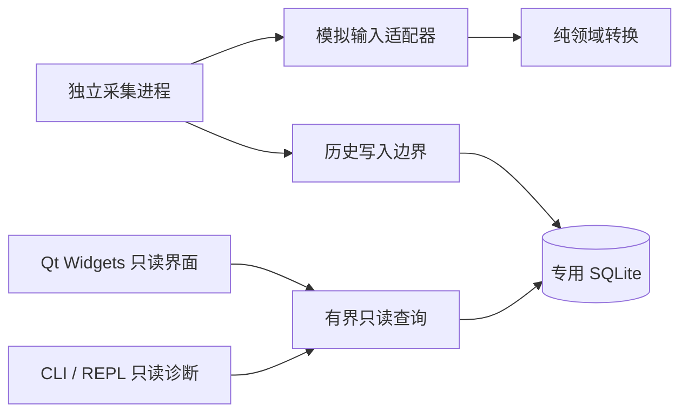

# C++ 模拟首版：架构与后续 Agent 交接

本文件是公开仓库中 C++ 实验首版的单一架构交接入口。只描述通用软件边界和匿名模拟，不包含现场流程、设备配置、端点、点表、协议握手或外部材料。模拟不是正式实现。运行命令见 [cpp-runtime/README.md](cpp-runtime/README.md)，实际验证见 [cpp-runtime/VALIDATION.md](cpp-runtime/VALIDATION.md)。

## 决策与目录

使用 C++17 / CMake。领域层只依赖标准库，不依赖 Qt、SQLite、网络或设备 SDK。旧 Node、Pi、契约文件独立保留；新程序不声称兼容旧工具或替代旧实现。

| 目录/模块 | 职责与允许依赖 |
|---|---|
| `cpp-runtime/src/domain.hpp/.cpp` | 纯合成状态转换；仅标准库 |
| `cpp-runtime/src/adapters.hpp/.cpp` | `SampleSource`、`HistorySink` 边界，唯一已实现输入是 `SimulationAdapter`；可依赖领域层 |
| `cpp-runtime/src/core.hpp/.cpp` | SQLite 写入适配器 `Writer`、只读查询 `read`、有界结果 `View`；不依赖 Qt |
| `cpp-runtime/src/collector.cpp` | 组合模拟输入和存储适配器；独立采集进程 |
| `cpp-runtime/src/diagnose.cpp` | 有界只读 CLI/REPL；只调用查询边界 |
| `cpp-runtime/src/hmi.cpp` | Qt Widgets 状态、模拟实体、异常和历史；只调用查询边界 |
| `cpp-runtime/tests` | 纯领域测试、独立进程黑盒验收、真实 Qt 事件循环刷新测试；全部合成数据 |

依赖方向是入口/界面 → 边界模块 → 领域；基础设施不得反向进入领域。当前小型 `runtime_core` 库同时承载读写基础设施实现，读端 API 与写端类分离，运行时只读由 SQLite open flags 和 query_only 执行。未来可按编译目标拆分库，但不得为了拆分改变已有观测语义。

## 进程与故障边界

采集由用户单独启动，不由 HMI/CLI 充当唯一父进程或服务监督者。界面退出、诊断退出不停止采集。Qt 定时器只检查异步查询是否完成，不在界面线程等待 SQLite；最多一个在途查询。查询失败或证据过期必须可见，不能继续将历史值显示为当前可信状态。

数据放专用本地目录，与源码、构建和旧数据库分离。SQLite 单写者，由独立租约排他事务约束；多写者启动失败。每帧事务提交、WAL/FULL；进程重启保留已提交历史并更换启动标识。模拟场景重新开始不能被称作业务恢复。数据目录/schema 不匹配拒绝运行，禁止自动覆盖。暂不支持共享盘、生产服务安装、历史容量管理、物理掉电保证或生产高可用。

质量与数值分开。不可用观测存空值，不能用零冒充成功采样。顺序由持久序号表达，墙钟只提供时间证据；启动内单调时间不能跨启动比较。对覆盖不足只报告 unknown，不把没有匹配记录推断成没有异常，也不自动推断根因。

## Adapter 扩展纪律

`SampleSource::next()` 和 `HistorySink::append()` 是明确扩展入口，当前承载合成观察。未来真实输入的时间戳、标识、错误及类型契约须在另一次评审中补齐，不能把模拟格式当正式外部协议。当前没有正式外部适配器，没有外部网络调用，也没有通用写设备方法。

新的外部实现必须独立模块、独立配置和单独验收；依赖版本与安全构建选项须锁定。未确认接口不得编造；只有测试替身时必须标注模拟。私有配置、凭据、证书、真实样本、其他项目代码或发行二进制不得进入公开仓库。

本版无诊断网络服务。若后续增加服务，需另行设计 loopback 绑定、token 验证、参数与资源预算；不能把“本机”当作免鉴权依据。旧只读契约保持不变；任何兼容声明必须列出具体已验收路由及未支持项。

## 故障验收与构建

空构建目录验证核心和 Qt 两种构建；核心可 `-DBUILD_HMI=OFF`。测试至少覆盖正常状态、异常、坏质量空值、模拟断链恢复、重启/进程崩溃后的已提交历史、第二写者拒绝、诊断/HMI 生命周期独立，以及只读输入限额。Qt offscreen 测试验证真实 Widgets 数据刷新，不等于目标桌面验收。

Windows 使用用户可写 D: 目录、MSYS2 MINGW64、C++17、CMake `MinGW Makefiles` 和 `mingw32-make`；非 UCRT64，不要求 Ninja。Qt 与编译器必须匹配，不混用其他项目运行库，不依赖 Qt Charts。完整下载、构建、运行命令在运行 README 维护，避免两处漂移。Linux 测试不能替代 Windows 或现场验收。

## 给后续 Agent 的改动范围

1. 先读本文件、运行 README、验证记录及相关测试，核验工作分支和未提交更改。
2. 领域任务只改纯状态转换和对应测试；不要把数据库、界面或 SDK 引入领域。
3. 存储任务只改存储/查询边界及持久化测试；保持单写者、空值质量和旧数据拒绝覆盖。
4. 界面任务只改 Qt 展示、导航与只读刷新；不得管理采集进程或新增设备写操作。
5. 诊断任务只改有界命令和证据展示；不得提供任意 SQL、shell、写点或虚构根因。
6. 外部适配任务先列出缺失契约与可复现本地验收，再独立实现；生产连接和部署不在本分支授权范围内。
7. 更新对应验证记录和本文件中的真实边界，只提交源码、测试与公开文档。不得修改 main、合并或发布；需要进一步授权的行为另行提出。

未实现事项必须保留为未实现，不通过命名、界面标签或文档将 mock 升格为正式功能。
