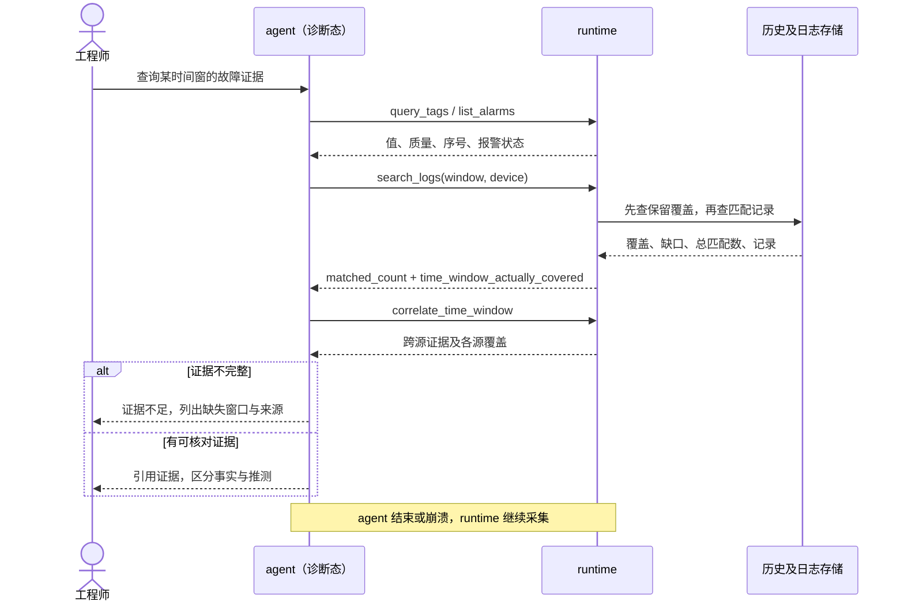
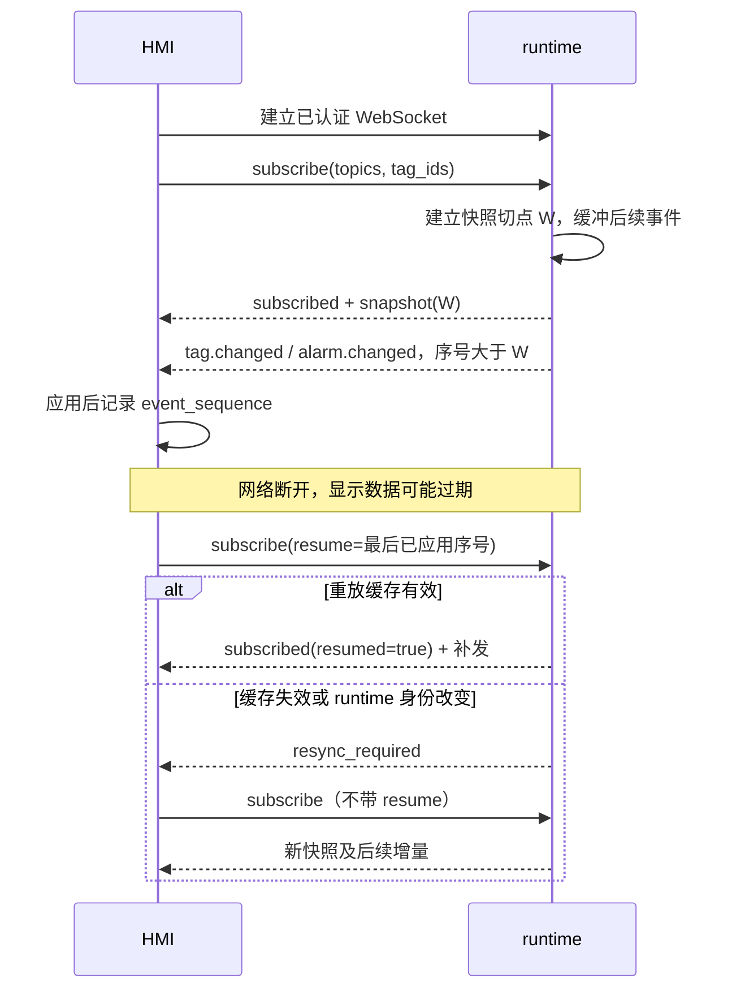
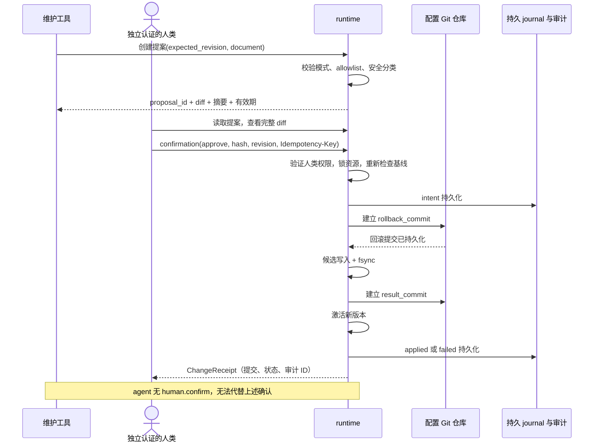

# T1：进程模型与接口契约草案

日期：2026-11-17。状态：可评审的契约草案，端点尚未实现。

## 已定约束与本次范围

runtime、agent、hmi 三个独立生命周期。runtime 无 LLM 依赖，采集、报警、历史、日志由其独立完成。OPC UA 为首个真实协议；S7 仅保留 driver 扩展位置。T0 的 LLM 项目经用户明确暂缓，不代表 T0 通过。

本次只定义接口和时序，不定义物流业务、画面、真实 PLC 点表、阈值或现场安全逻辑。类型见 `contracts/runtime-v1.ts`。接口地址均为本项目拟定的相对路径，不是已运行的服务。

## 进程与存储所有权

| 组件 | 启停责任 | 自有资源 | 与 runtime 的关系 |
|---|---|---|---|
| runtime | 独立服务管理器；Windows 部署时由独立服务承载 | driver、SQLite WAL、JSONL、配置 Git 仓库、持久事件序列、审计 | 不加载 pi，不依赖 agent/hmi 存活 |
| agent | 独立进程，按需运行 | pi 会话、轻量 HTTP 工具扩展 | 诊断态只读凭据；无日志目录写权限 |
| hmi | 浏览器；以后可由 Electron 承载 | 展示与订阅状态 | HTTP 初始查询 + WebSocket 推送；失联时显式标注 |

Electron 主进程不得成为 runtime 的唯一父进程/看门狗。关闭窗口、崩溃或更新 Electron，runtime 仍应继续运行。Windows 服务包装方式尚未选型，不能把这一条视为已验证。

runtime 是数据目录的唯一写入者。agent 无 SQLite、日志及运行中配置目录的直接写权限。维护态的 edit/bash 仅可在 runtime 停机或测试工位开放；该限制由进程权限和服务端模式检查执行，不能仅依赖提示词。联锁、安全资源即使在维护态也拒绝写入。

2026-11-17 业务澄清：用户确认正常业务由 runtime 自动执行。经审核的业务白名单/状态机可自动进行心跳、PLC 握手和外部业务交互，不经 agent、不逐次要求人工确认。配置/阈值/画面/process/tag 变更仍执行本文受控写流程；agent 不获得通用 PLC 写 API，联锁与安全逻辑仍禁写。具体边界及未定点位绑定见 `docs/business/requirements-v0.1.md`；本条不是已部署功能。

## 鉴权与查询约定

- 拟默认绑定回环接口；远程访问必须另行配置认证与加密。回环地址不等于可信身份。
- 权限分离：`diagnostic.read`、`change.propose`、`human.confirm`。诊断 agent 只有第一项，未来维护工具可提案但不持有人类确认权限。
- HMI 确认操作者必须单独认证，身份从会话取得。无共享给 agent 的确认密钥；请求 body 不接受自报操作者身份。
- 浏览器会话校验 Origin、CSRF；WebSocket 校验身份和 Origin。禁止把凭据放进 URL，错误和日志不得记录凭据。
- 所有输入严格校验，拒绝未知字段；SQL 参数化。拒绝任意 SQL、正则执行、路径遍历、脚本和 PLC 原始写请求。
- 时间窗为 UTC RFC3339 `[from,to)`；GET 窗口展开为 `from`、`to`，数组使用重复键，例如 `tag_ids=A&tag_ids=B`。游标为不透明字符串，绑定主体、规范化筛选和快照。
- 草案默认：分页 200、最大 1000；tag 每次最多 500；原始查询最长 24 小时；聚合查询最长 366 天；关联窗口最长 1 小时；请求最长 10 秒。超限显式返回错误，不静默截断。参数在部署配置中固定并记录版本。
- 页间保持同一快照；游标过期返回 410。分页不改变筛选范围与统计口径。不存在的 tag 通过 `missing_tag_ids` 显式返回。
- HTTP 错误统一为 `ApiError`：400 参数、401 未认证、403 越权/安全资源、404 资源不存在、409 基线冲突/模式冲突、410 游标或提案过期、413 数量超限、422 不合法资源内容、429 限流、503 存储不可用/无法在限额内完成查询。

### 只读端点与 agent 工具

| 相对端点 | 工具 | 关键语义 |
|---|---|---|
| `GET /api/v1/health` | 不默认注册为独立工具 | driver 链路/会话/订阅三层状态，持久化健康，runtime 模式 |
| `GET /api/v1/tags` | `query_tags` | 最新值、quality、原始源/服务器时间、runtime 接收时间与序号 |
| `GET /api/v1/history` | `query_history` | 必须指定分辨率；raw 与聚合类型不同；返回覆盖情况 |
| `GET /api/v1/alarms` | `list_alarms` | 条件状态、确认状态、抑制状态分别返回 |
| `GET /api/v1/logs` | `search_logs` | 必须返回总匹配数、实际覆盖窗口、缺口与轮转策略版本 |
| `GET /api/v1/correlations` | `correlate_time_window` | 返回跨源证据及各源覆盖，不生成根因断言 |

日志 `matched_count` 是固定快照下完整筛选窗口内的精确总数，分页的 `items.length` 不是它。无法精确计算时返回错误，不能返回猜测值。覆盖窗口来自记录/轮转元数据，不能从第一条、最后一条匹配日志推导：没有匹配内容的窗口也可能完整覆盖。

`time_window_actually_covered` 使用区间数组，表达中间缺口；`complete` 表示该采集源在窗口内有完整记录能力，不表示设备未出故障。时钟回跳导致无法可靠映射时应返回 `unknown`/缺口，不能编造覆盖。`matched_count=0` 且覆盖不完整时，诊断结论必须为“证据不足”，不能断言“无异常”。覆盖完整但零匹配时只能说“指定窗口和筛选下未找到记录”。

所有样本携带源时间与服务器时间；展示事件发生时间按 SourceTimestamp、ServerTimestamp、接收时间优先级选取，保留选取依据。排序和去重使用持久序号，不使用可能回跳的墙钟。聚合数值只统计 good 且为数值的样本；坏质量数单列。历史保留和聚合容量由 T2 定义。

## WebSocket：`/api/v1/events`

协议标识 `ltp.runtime.v1`，JSON 消息使用类型文件定义的联合类型。

1. 完成认证后发送 `subscribe`，指定 topics 和 tag_ids。tag topic 必须明确点位集合，不默认订阅全厂；不匹配的组合返回参数错误。
2. 首次订阅：runtime 建立一致性切点 W，先缓冲 W 之后的事件，发送 `subscribed(resumed=false)`，再发送原子 `snapshot(watermark=W)`，随后按事件序列发送 W 之后的增量。快照必须覆盖选择的报警、点位和健康状态；不相关 topic 的数组为空。
3. 断线重连提交 runtime_id 与最后已应用的 event_sequence。缓存有效则 `subscribed(resumed=true)` 后补发；否则发送 `resync_required`，客户端重新发起无 resume 的订阅并用快照整体替换本地状态。
4. 持久化 runtime_id 在重启后不变，数据重建后改变。event_sequence 为跨重启持久分配的独立事件序列；同一序列对应的事件内容不可变化。序列缺号不等于丢包（可能被筛选掉）；客户端不据此自行判缺失。
5. 客户端按 `(runtime_id,event_sequence)` 去重，更新“最后已应用序号”必须在成功应用完整事件之后。快照状态和 watermark 也必须一起替换。
6. 重放缓存草案上限为 10 分钟或 10 万条，先到为准；重启后无法补发即要求重同步，不假装已补齐。慢消费者队列上限 1000 条或 4 MiB，先到为准，发送 resync_required 并以 1013 关闭；禁止无提示丢数据。
7. 每 5 秒发送心跳，连续 15 秒未收到服务端消息，HMI 显示“连接中断，数据可能过期”。WebSocket 心跳只证明通道存活；点位是否新鲜看 quality 和 driver 订阅健康。重连退避 1–30 秒并加入抖动。
8. 订阅数、消息大小和发送频率设上限，避免 HMI 拖慢采集。趋势历史通过 HTTP 取聚合数据，WebSocket 只补实时增量，不替代历史接口。

## 受控写：提案与人工确认

| 相对端点 | 权限/作用 |
|---|---|
| `POST /api/v1/change-proposals` | 维护主体创建提案；只存草案，不能激活配置 |
| `GET /api/v1/change-proposals/:id` | 读取本人可见提案；人类审核员可按授权读取 |
| `POST /api/v1/change-proposals/:id/confirmation` | 仅独立认证的人类确认会话；approve/reject |
| `GET /api/v1/change-proposals/:id/receipt` | 查询提交、应用状态及审计回执 |

诊断态不注册提案和确认工具。未来维护态的配置/画面/阈值提案只接受资源 allowlist 中的逻辑 ID，不接受文件路径、任意 git 操作或 PLC 地址。资源安全分类由 runtime 管理，不能由请求方声明。配置默认只在 stopped/test_station 应用；在线热更新须以后逐资源明确授权，当前不假定允许。

报警确认和搁置也是受控写，不能藏在只读 `list_alarms` 内。搁置必须有理由和有上限的期限，自动恢复；联锁/安全报警不允许搁置。报警确认不清除实际报警条件。具体现场权限及最大期限尚待业务输入，未配置时拒绝动作。所有动作统一经过 diff、人工确认、Git 回滚点和审计；报警动作的 Git 提交记录授权动作清单，不把实时报警数据库纳入 Git。

确认流程：

1. 验证权限、runtime 模式、资源分类、内容及 expected_revision，服务端生成规范 diff 和 SHA256。提案默认 10 分钟过期，使用服务端单调时间判定；重启后所有未处理提案失效。
2. 人类查看完整 diff，确认请求绑定 proposal_id、diff 摘要、基线版本。认证主体是审计操作者，不能由 agent 填入。
3. 确认时重新检查权限、模式、资源分类、过期、基线，并对同一资源加互斥锁。任何基线改变均返回 409；旧确认不能复用到新 diff。
4. 确认端点必须提供 `Idempotency-Key`，按主体+键+规范请求摘要持久化。同键同请求返回同一回执，同键不同请求返回 409；提案只能从 pending 原子转换一次。applying 状态返回 202，客户端查询 receipt，不创建第二次执行。
5. 在激活任何变化前落盘写入审计 intent，建立并校验 Git rollback_commit，写入候选文件并 fsync，建立 result_commit，再执行激活；落盘 applied/failed 审计后返回回执。无法落盘或 Git 失败时禁止激活。
6. Git、文件和 SQLite 不具备跨系统原子提交，不能声称一步事务解决。T4/T8 必须实现持久操作 journal 与崩溃恢复：保留旧版本和候选版本，以 operation_id 对齐审计/提交/激活；启动先恢复未完成操作，状态不确定则拒绝新受控写，不阻塞未受影响的采集。
7. 回滚也是新提案、新人工确认、新审计，不能让 agent 任意执行 git reset。安全资源始终禁写。

配置 Git 仓库由 runtime 独占，和当前项目源码仓库分开。Git 提交是回滚证据，不代替审计；审计日志 append-only，agent 只读，保留窗口必须明确。

## 三条验收时序图

### agent 排障一次

### HMI 订阅一次

### 受控写一次

## 验收边界与后续工作

T1 交付为类型定义 + 本文三条时序图；目前只有文档/语法检查，未实现 HTTP、WS、鉴权、日志查询或提交事务，不能视为运行验证。

本次检查：Node v24.22.1 使用 `stripTypeScriptTypes` 后交由 `SourceTextModule` 解析成功；文档含三条 Mermaid 时序图，关键日志字段与人工确认权限结构检查通过；`git diff --check` 通过。没有安装额外开发依赖，没有完成 TypeScript 语义类型检查或 Mermaid 渲染检查。直接 `node --check` 不能在当前无 ESM 项目配置下检查该 `.ts` 文件，其失败不记作通过。

T2 定义 SQLite DDL、报警状态转换、quality 口径、容量和降采样；T3 才用 mock 验证闭环与订阅重建；T4 做持久序号/轮转/掉电与时钟测试；T5 接 OPC UA 测试工位；T6 注册只读诊断工具；T7 等用户业务说明后再做画面；T8 落地受控写。

本次提出的接口命名、分页/超时/缓存上限、默认写入模式均为工程草案，并非用户已确认的现场参数。无需 PLC 或 LLM 即可继续细化数据模型；实机证书、安全分类、部署身份、Windows 服务及现场容量需后续实证。
